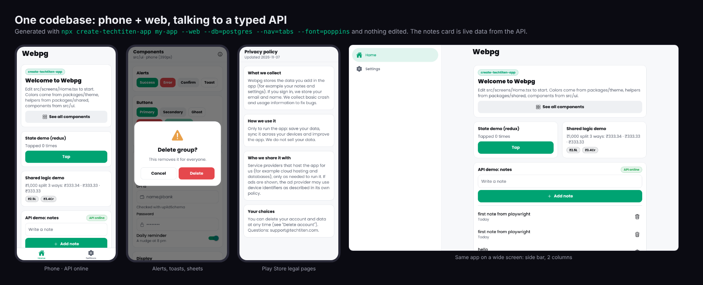
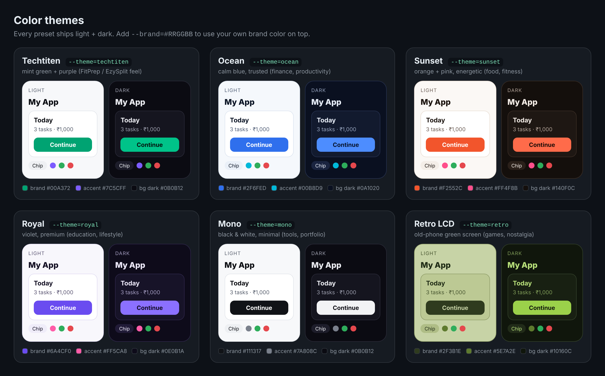
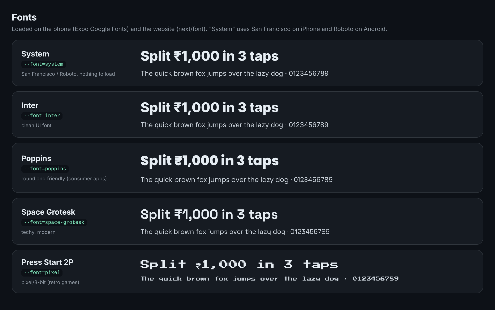
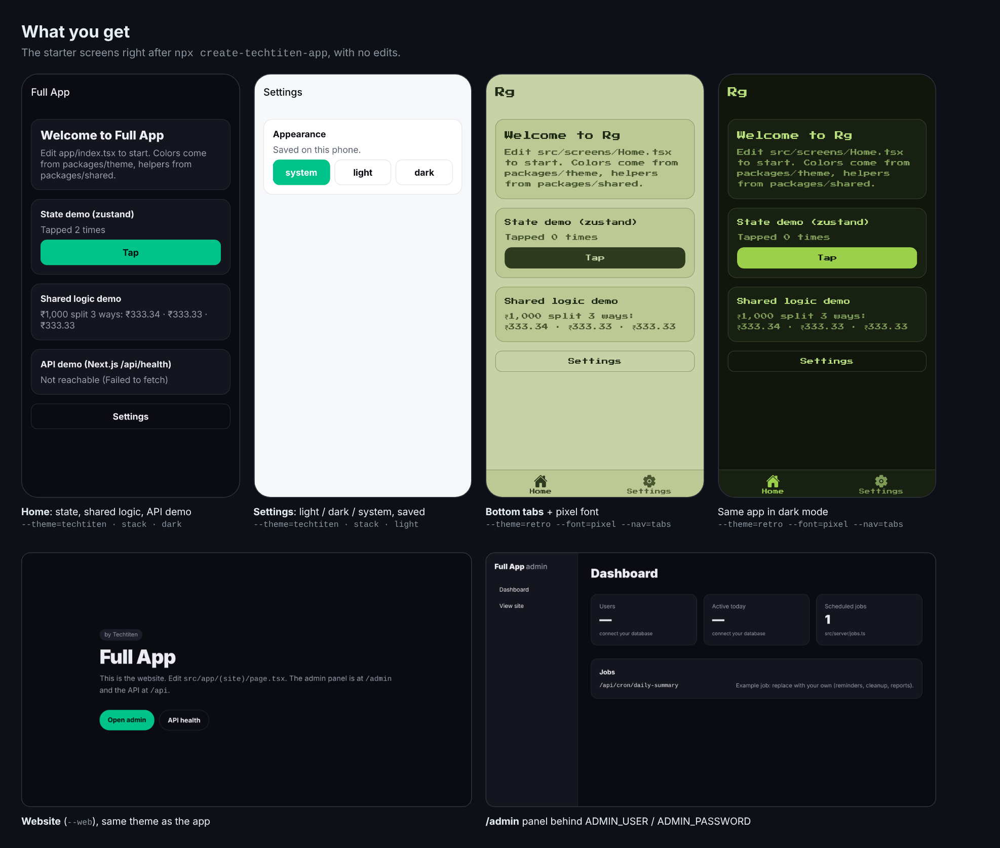

# create-techtiten-app

One command for a new app, with the same structure every time: an Expo app that runs on Android, iOS **and the web**, an optional API (Next.js, Express or Fastify) with a database, and shared theme, logic and API types.

```
npx create-techtiten-app my-app
```



```
my-app/
├─ apps/mobile        Expo (latest SDK), Expo Router: Android, iOS and responsive web
├─ apps/web           Next.js (latest): website, /admin, /legal pages, API under /api     --web
├─ apps/api           Express or Fastify API                                               --api (without --web)
├─ packages/config    name, package id, domains, ports, deep links, CORS: one place
├─ packages/theme     colors, spacing, radius, font sizes
├─ packages/shared    functions, zod schemas, the typed API contract, legal page text
├─ techtiten.json     what you picked (used by `add`)
├─ .github/workflows  Android build → Google Play (only when mobile changes) + web check
└─ AGENTS.md, STATUS.md, .gitignore (secrets blocked)
```

## Run it
```
cd my-app
npm run dev        # API + Expo together. Press a for Android, w for web.
```
The phone finds your API on its own (same Wi-Fi), and the API docs with a "Try it" button for every route are at `http://localhost:4000/docs` (or `http://localhost:3000/api/docs` with Next.js).

## Options
Run `npx create-techtiten-app --help` any time. It asks these questions, or you pass flags:

| Question | Flag | Choices |
|---|---|---|
| Display name | `--name="My App"` | anything |
| Package id | `--package=com.techtiten.myapp` | permanent once on Play |
| Next.js app | `--web` / `--no-web` | website + `/admin` + API under `/api` |
| API (only without web) | `--api=none\|express\|fastify` | standalone API in `apps/api` |
| Database (only with an API) | `--db=none\|firestore\|mongo\|postgres` | none = in-memory example data |
| Navigation | `--nav=stack\|tabs` | tabs = bottom bar on phones, side bar on wide screens |
| State + API data | `--state=zustand\|redux` | Zustand + TanStack Query, or Redux Toolkit + RTK Query |
| Color theme | `--theme=<preset>` | `techtiten`, `ocean`, `sunset`, `royal`, `mono`, `retro` (green LCD) |
| Brand color | `--brand=#FF3366` | optional, replaces the preset's brand color |
| Font | `--font=<font>` | `system`, `inter`, `poppins`, `space-grotesk`, `pixel` |
| Notifications | `--notifications` | daily local reminder + push (push needs an API) |
| Ads | `--ads` / `--no-ads` | AdMob banner, test ads in development |

Other flags: `--yes` (no questions), `--skip-install`, `--no-git`, `--help`, `--version`.

### Defaults (Enter on every question, or `--yes`)
| Option | Default |
|---|---|
| Display name | folder name in Title Case (`my-app` → `My App`) |
| Package id | `com.techtiten.` + folder name without dashes |
| Next.js app | yes |
| Database | none |
| Navigation | stack |
| State | Zustand + TanStack Query |
| Theme / font | `techtiten` / system |
| Notifications, ads | off |

Only what you pick gets installed: one font, one state library, one database driver, no ads SDK unless you ask.

### Color themes


Your colors end up in `packages/theme/src/colors.ts`: one file, used by the phone app and the website.

### Fonts


### Examples
```
npx create-techtiten-app shop --yes --web --db=postgres --theme=sunset --font=poppins --state=redux
npx create-techtiten-app tracker --yes --no-web --api=fastify --db=mongo --notifications
npx create-techtiten-app retro-games --yes --no-web --ads --theme=retro --font=pixel --nav=tabs
```



## Add things later
Run inside a project:

| Command | What it does |
|---|---|
| `npx create-techtiten-app add route tasks` | Contract + `routes / controller / service / model` for your database, wired into the API and the typed hooks. Postgres: adds the table too. |
| `npx create-techtiten-app add notifications` | Daily reminder switch in Settings, push token sign-up, push send route (+ admin form on Next.js) |
| `npx create-techtiten-app add ads` | AdMob banner |
| `npx create-techtiten-app add theme ocean --brand=#3355FF` | Switch colors |
| `npx create-techtiten-app add font inter` | Switch the font (installs the new one, removes the old one) |

## What you get

**Phone + web app (`apps/mobile`)**
- Component kit in `src/ui`: Button (variants, sizes, icons, loading, haptics), IconButton, Header (safe area, back arrow, large titles), Screen, Card, Row, Input (label, error, show/hide password), Switch, Badge, Avatar, ListItem, Skeleton, Loader, EmptyState, bottom Sheet, and `useAlert()` for nice alerts, confirms and toasts. See them all on the `/kit` screen.
- Responsive: `useResponsive({ phone, tablet, desktop })`, content width capped on big screens, tabs become a side bar.
- Typed API hooks: `useApiQuery('notesList', { query: { limit: 20 } })`, `useApiMutation('notesCreate')`. Rename a field in the contract and the app shows a type error.
- Force update (blocking "Update needed" screen below `MIN_APP_VERSION`), rate-the-app prompt after happy moments, Settings with appearance (system/light/dark), legal pages and version.
- Reanimated 4 + Worklets + Gesture Handler, SDK-matched. Release signing plugin. Deep links (`<slug>://` and https App Links).

**API (`apps/api` or Next.js `src/server`)**
- One contract (`packages/shared/src/routes`): every route's method, path and zod input/output, written once. Requests are validated against it (clean 400s), the app's client is typed from it, and `/docs` (OpenAPI 3.1 + Scalar) is generated from it.
- Feature folders: `modules/<feature>/<feature>.{routes,controller,service,model}.ts`, plus `config/env.ts` (zod-checked env), `lib/` (auth, errors, logger), `jobs/`.
- Helmet, CORS from `packages/config`, rate limit (Express/Fastify), request ids, one error format (`{ error: { code, message } }`), admin routes behind `ADMIN_TOKEN`, cron routes behind `CRON_API_KEY`.
- Databases: Firestore (firebase-admin), MongoDB (mongoose), Postgres (Drizzle + `db:push`), or in-memory. `docker-compose.yml` for local Mongo/Postgres. A dev `.env` with random secrets is written for you (git-ignored).
- Deploys to Vercel as is (`vercel.json` for Express/Fastify; Next.js just works).

**Website (`apps/web`)**: landing page in your theme, `/legal/privacy`, `/legal/terms`, `/legal/delete-account`, `/legal/support` for the Play listing, `/admin` behind basic auth (password = `ADMIN_TOKEN`) with app-version and push cards, `/.well-known` files for Android App Links and iOS Universal Links.

**CI:** `android.yml` builds a signed AAB and uploads to Play (internal track). Secrets: `ANDROID_KEYSTORE_BASE64`, `ANDROID_KEY_ALIAS`, `ANDROID_KEYSTORE_PASSWORD`, `ANDROID_KEY_PASSWORD`, `ANDROID_SERVICE_ACCOUNT_JSON`.

## Always the latest
- The base apps come from `create-expo-app@latest` and `create-next-app@latest`.
- Native packages are added with `npx expo install`, which picks the versions for that SDK. Nothing is pinned in this package.
- No `android/` or `ios/` folders are stored: they're generated at build time (`expo prebuild`).
- One React version for the whole repo (web is pinned to the version Expo installed).
- Later: `npm run upgrade:mobile` (latest Expo SDK) and `npm run upgrade:web` (latest Next.js).

## Develop this package
```
bin/index.mjs      entry: create or add
bin/options.mjs    every question/flag (--help is built from it)
bin/presets.mjs    themes and fonts
bin/project.mjs    answers -> files (shared by create and add)
bin/create.mjs     the create flow
bin/add.mjs        the add command
templates/         files copied into new projects (__TOKENS__ are replaced)
```
```
npm install
node bin/index.mjs test-app --yes        # try it
npm publish                              # first time: npm login
```
